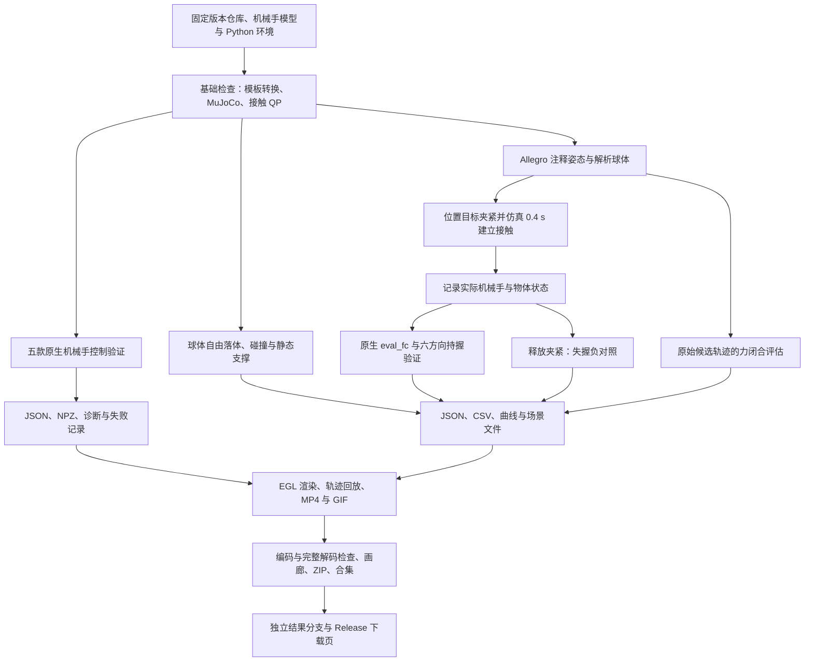

# Dexonomy 当前 MuJoCo 仿真管线

文档更新：2026-10-21（Asia/Shanghai）  
仿真记录：2026-10-16  
代码仓库：`Lvguichen-C/Dexonomy`  
仿真使用的代码提交：`d561ff9df8545deef7a3f9e7cfb4045ef66f6913`  
已发布动画的固定提交：`ede26e1d8acbae0481fdabb1611289ebd925e906`

本文记录当前云环境中实际执行的仿真、验证和动画交付流程。当前管线验证了模板转换、机械手控制、解析球体动力学、接触建立后的持握及失握检测；没有完成依赖 GPU 和外部物体数据集的完整 Dexonomy 抓取合成。

## 1. 管线总览



结果分为三类：真实通过、真实失败、预期失握负对照。`physics_results.json` 的总体 `passed` 表示该验证脚本的断言通过，不能解释为所有抓取候选均成功；其中原始候选的 `eval_fc=False` 是明确保留的失败记录。

## 2. 环境与目录

### 2.1 已安装环境

| 项目 | 当前配置 |
|---|---|
| 平台 | Linux x86_64，CPU，无可用 NVIDIA GPU/驱动 |
| Python | 3.10.22 |
| 虚拟环境 | `/workspace/venvs/dexonomy` |
| PyTorch | `2.5.1+cpu` |
| MuJoCo | `3.3.3` |
| Warp | `1.8.0` |
| NumPy / Trimesh | `2.2.6` / `4.5.3` |
| QP | `qpsolvers==4.8.0`，Clarabel 求解器 |
| 无界面渲染 | EGL，`MUJOCO_GL=egl` |
| 动画编码 | 系统 FFmpeg / ffprobe，libx264，Pillow |
| 必要子模块 | `mujoco_menagerie`，提交 `bf04290ac7911fa7a39339c7e507792fd464c438` |

`mujoco_menagerie` 提供 Shadow、Allegro、Leap 模型依赖的资源。可选 BODex 没有初始化或编译。基础依赖检查确认 70 个已安装包兼容；安装版本记录在 `resolved-requirements.txt`。

### 2.2 云环境中的文件布局

```text
/workspace/
├── Dexonomy/                         # 原始代码与模型，main 源码未修改
│   ├── dexonomy/sim/mujoco_env.py     # 原生仿真、控制与评估 API
│   ├── dexonomy/util/traj_util.py    # 原生轨迹规划器
│   ├── assets/hand/                  # 原生机械手模型及注释
│   ├── third_party/mujoco_menagerie/
│   └── output/animation-delivery/    # 交付副本、校验及发布记录，Git 忽略
├── venvs/dexonomy/
└── dexonomy-onboarding/
    ├── install.sh
    ├── activate.sh
    ├── smoke.py
    ├── resolved-requirements.txt
    ├── templates/allegro/            # 保留的 Allegro 模板
    └── mujoco-validation/
        ├── validate_physics.py
        ├── physics_results.json
        ├── drop_trace.csv
        ├── retention_trace.csv
        ├── negative_control_trace.csv
        ├── settled_grasp_fixture.json
        ├── physics_validation.png
        ├── REPORT.md
        ├── hands/
        │   ├── validate_hands.py
        │   ├── diagnose_shadow.py
        │   ├── results.json
        │   ├── shadow_diagnostics.json
        │   ├── <hand>.json
        │   └── <hand>_trajectory.npz
        └── animations/
            ├── render_physics.py
            ├── render_hands.py
            ├── render_utils.py
            ├── package_results.py
            ├── physics/              # 10 对 MP4/GIF 及 manifest
            ├── hands/                # 6 对 MP4/GIF 及 manifest
            ├── mano_unavailable.mp4  # 仅为加载失败说明卡
            ├── manifest.json
            ├── quality_checks.json
            ├── index.html
            ├── all_results.mp4
            └── all_animations.zip
```

使用现有隔离云任务中的 checkout，不额外创建 Git worktree。验证辅助脚本、场景及输出保存在仓库外或已忽略的 `output/` 路径；原始源码、模型、依赖声明和锁文件保持原样。

## 3. 当前云实例的执行入口

以下命令依赖上面的保留目录和已经安装的环境。

### 3.1 环境激活与依赖检查

```bash
cd /workspace/Dexonomy
source /workspace/dexonomy-onboarding/activate.sh
uv pip check --python /workspace/venvs/dexonomy/bin/python
```

激活脚本设置虚拟环境、`/workspace` 下的 uv / Matplotlib / Warp 缓存、Matplotlib `Agg` 后端，并将 OpenMP / OpenBLAS 线程数限制为 2。每个新 shell 都需要重新激活。

仅在需要重新安装或刷新依赖时运行：

```bash
bash /workspace/dexonomy-onboarding/install.sh
```

安装脚本通过 HTTPS 初始化指定的 Menagerie 子模块，用 uv 准备 Python 3.10.22 和独立虚拟环境，从官方 CPU wheel 索引安装 `torch==2.5.1+cpu`，再 editable 安装项目并检查依赖。它不安装 GPU 驱动、物体数据集或 BODex。

### 3.2 基础检查

```bash
python /workspace/dexonomy-onboarding/smoke.py
```

检查内容：

1. 调用真实 `dexrun op=tmpl hand=allegro n_worker=2`，将全部 11 个注释转换到新的临时目录。
2. 检查输出数量、模板名称、`grasp_qpos` 形状 `(1, 23)`、有限位姿与非空接触数据。临时目录在检查完成后删除，避免旧文件造成假通过。
3. 调用原生 `MuJoCo_OptEnv`，运行 100 步、0.2 s，检查位置和速度有限。
4. 调用原生 `ContactQP` / Clarabel，检查两侧接触产生非零平衡力，残差小于 `1e-6`；实际残差约 `4.39e-14`。

项目模板转换的 worker 会捕获异常，所以必须检查生成文件，不能只依赖命令退出码。

### 3.3 物体、持握与负对照验证

```bash
MUJOCO_GL=egl python /workspace/dexonomy-onboarding/mujoco-validation/validate_physics.py
```

该脚本已通过，生成物理结果 JSON、逐步 CSV、曲线、球体 XML、稳定抓握场景及基础持握 GIF。

### 3.4 原生机械手验证与 Shadow 诊断

```bash
python /workspace/dexonomy-onboarding/mujoco-validation/hands/validate_hands.py
```

当前预期退出码为 **1**，因为 Shadow 和 MANO 未通过；脚本仍保存五款模型的完整结果。不要用 `|| true` 把失败改写为成功，也不要在 `set -e` 的一串命令中忽略这一已知退出状态。

```bash
python /workspace/dexonomy-onboarding/mujoco-validation/hands/diagnose_shadow.py
```

此脚本记录 Shadow 的两次补充失败诊断。它本身退出码为 **0**，但 JSON 中的场景状态为 `fail`；退出码表示诊断文件写出成功，不表示仿真通过。

## 4. 机械手模型与控制验证

使用仓库原生 `HandCfg`、`MuJoCo_OptEnv` 和：

```python
env.set_ctrl(joint_position_target, ctrl_type="joint_angle")
env.step_sim(1)
```

仿真积分器为 `implicitfast`，步长 2 ms，请求 1250 步、2.5 s。关闭重力，不放入外部物体。几何及执行器拓扑来自原生模型，运行时使用项目 `MuJoCo_OptEnv` 的接触和约束设置，包括无摩擦的 `condim=1`、关节 margin 及求解参数覆盖。

每个关节从行程的 35% 出发，用 smoothstep 在 0.75 s 内移动至行程中点，再保持 1.75 s。初末目标都与限位相隔大于 0.1 rad，以避开项目继承的关节 margin。

运行前确定的判据：

- 位置、速度、控制与执行器力均为有限值。
- 仿真时钟至少推进 2 s，且没有自动重置。
- 实际最大关节运动大于 `1e-3 rad`。
- 最大硬限位偏差不超过 `0.01 rad`。
- 执行器空间最终 RMS 目标误差小于初始误差。
- MuJoCo 警告数量为 0。

控制接口使用传动矩阵 `M @ q` 映射目标。Shadow 有 22 个关节、18 个执行器及 4 个腱耦合执行器，因此以执行器空间误差作为收敛判据，不能要求所有关节独立跟踪。

| 模型 | 关节 / 执行器 | 初始 → 最终执行器 RMS 误差 | 结果 |
|---|---:|---:|---|
| Allegro | 16 / 16 | 0.246117 → 约 0 rad | 通过，完成 2.5 s |
| Leap | 16 / 16 | 0.371055 → 0.011902 rad | 通过，完成 2.5 s |
| Unitree G1 | 7 / 7 | 0.263482 → 0.005810 rad | 通过，完成 2.5 s |
| Shadow | 22 / 18 | 未收敛 | 0.344 s 出现不稳定加速度，发生 6 次时钟重置；最终时钟为 1.754 s |
| MANO | 未加载完成 | 未运行 | `assets/hand/mano/right.xml:5` 中 `noslip_stepations` 属性不符合 MuJoCo 3.3.3 XML 模式 |

Shadow 的补充诊断采用接近张开的内部姿态，仅向关节中点移动 10%。2 ms 步长在 0.170 s 出现警告；0.5 ms 步长在 0.7295 s 出现警告，均未完成原定 2.5 s。这些是所测场景的失败结果，不代表所有 Shadow 姿态均失败。

## 5. 球体落地与静态支撑

通过 `MuJoCo_EvalEnv` 加入解析球体及地面，显式启用重力；不需要下载外部物体资产。

| 参数 | 设置 |
|---|---|
| 球体半径 / 质量 | 0.025 m / 0.1 kg |
| 球心初始位置 | `[0.3, 0, 0]` m |
| 地面高度 | `z = -0.25 m` |
| 重力 | `[0, 0, -9.81]` m/s² |
| 积分步长 / 步数 | 0.002 s / 1500 |
| 总仿真时间 | 3 s |
| 理论静止球心高度 | −0.225 m |
| 理论静态支撑力 | 0.981 N |

每一步检查位置、速度、加速度有限且无警告。额外断言：

- 前 0.12 s 的自由落体轨迹与解析解误差小于 3 mm。
- 最终高度与理论值偏差小于 2 mm。
- 2–3 s 的平均支撑力与 `mg` 偏差小于 5%。
- 该稳态区间的垂直速度绝对值小于 `0.001 m/s`。

实际结果：自由落体最大误差 **1.158 mm**，最终高度 **−0.225367 m**，稳态支撑力 **0.981 N**，没有 MuJoCo 警告。

## 6. Allegro 接触建立与六方向持握

### 6.1 输入与单位

使用 `assets/hand/allegro/raw_anno/fingertip_mid.yaml` 的 16 维关节注释，拼接单位根位姿得到 23 维机械手位姿。

位姿按 `[x, y, z, qw, qx, qy, qz]` 存储；距离单位 m，关节角单位 rad，时间 s，质量 kg，力 N，评估旋转误差单位为度。

| 参数 | 设置 |
|---|---|
| 球体半径 | 0.0383 m |
| 初始球心 | `[0.020, 0.0051, 0.0973]` m |
| 密度 / 质量 | 300 kg/m³ / 0.07060024 kg |
| 摩擦参数 | `[0.6, 0.02]`，沿用项目的切向与扭转摩擦设置 |
| 环境 | `MuJoCo_EvalEnv`，机械手自由根关节与 mocap 约束 |
| 步长 | 0.004 s |
| 手指夹紧目标 | 在原始 16 个关节位置目标上各增加 0.05 rad |
| 接触建立 | 100 步，0.4 s |

夹紧量是位置控制目标的偏置，不是额外施加的手指力矩，也没有用 GPU 求解新的抓取姿态。

接触建立后保存实际手位姿及球体位姿，并按实际球体位姿重建评估场景，使每次重置恢复到真实建立的接触。检查至少两个不同机械手刚体接触，最大穿透小于 2 mm；实际为 **3 个接触刚体、最大穿透 0.474 mm**。原始注释起点最大穿透为 0.963 mm。

### 6.2 评估过程

核心流程如下，完整实现位于 `validate_physics.py`：

```python
q = annotation_with_identity_root_pose()
squeeze = q.copy()
squeeze[7:] += 0.05

env.reset_qpos(q)
env.set_ctrl(squeeze)
env.step_sim(100)  # 0.4 s，实际建立接触

settled_hand = env.get_hand_qpos().copy()
settled_object = env.get_active_obj_pose().copy()

# 用实际物体位姿重建场景，然后调用原生规划器与评估器。
plan = planner.plan_trajectory(
    settled_object, settled_hand, settled_hand, squeeze, None
)
success, _, _ = evaluation_env.eval_fc(*plan, 0.05, 15.0)
```

上述代码是流程示意；函数 `annotation_with_identity_root_pose` 代表文中所述注释读取，实际脚本入口为 `q_annotation()`。构造 `evaluation_env` 时，将实际物体位姿设为场景初始位姿；物体仍有自由关节，能够在评估中动态运动。

原生 `eval_fc` 返回 `True` 后，再逐方向重复评估并记录每一步数据：

1. 重置到同一已建立接触的手/物体状态。
2. 执行原生短轨迹，50 步、0.2 s。
3. 分别施加世界坐标系 `+X、−X、+Y、−Y、+Z、−Z` 外力。
4. 每个方向运行 500 步、2 s。
5. 每步检查有限状态、原生关节限位和零警告，记录位移、旋转、接触数量、法向接触力。

**此处重力关闭。** 每次只施加一个方向的重量等效外力，力大小为项目的 `mass × 9.8 = 0.691882 N`，不是“重力再叠加一个同样大的外力”。评估器使用摩擦接触；`MuJoCo_OptEnv` 的无摩擦设置不用于持握验证。

位移和旋转均相对接触建立后的物体位姿计算。阈值沿用 `dexonomy/config/op/eval.yaml`：最大位移小于 **0.05 m**，最大旋转小于 **15°**。

| 外力方向 | 全过程最大位移 | 全过程最大旋转 | 最少接触数 | 结果 |
|---|---:|---:|---:|---|
| +X | 1.650 mm | 0.936° | 3 | 通过 |
| −X | 1.784 mm | 0.900° | 3 | 通过 |
| +Y | 3.392 mm | 2.422° | 3 | 通过 |
| −Y | 2.056 mm | 1.200° | 3 | 通过 |
| +Z | 1.368 mm | 0.888° | 3 | 通过 |
| −Z | 1.153 mm | 0.717° | 3 | 通过 |

### 6.3 负对照与原始候选失败

**释放夹紧的负对照：** 从同一稳定抓握出发，恢复原始手指位置目标，施加 −Z 外力 2 s。脚本断言物体位移大于 5 cm 且最终接触数为 0。实际位移 **8.766 m**，接触归零，说明检测能够识别失握。

**原始候选轨迹：** 同一个解析球体直接使用原始注释的 `q → q → squeeze` 轨迹，调用原生 `eval_fc`，结果为 `False`。动画复现中，0.4 s 结束时位移 **37.792 mm**、旋转 **31.473°**，在力闭合评估阶段未通过旋转阈值。

因此，已经建立接触后的持握通过，不等于原始注释到抓取完成的整条轨迹通过，也不等于完整抓取合成通过。`validate_physics.py` 保留原始候选的布尔结果；其总体通过不要求把这个候选变为成功。

## 7. 数据与判据输出

| 文件 | 用途 |
|---|---|
| `physics_results.json` | 球体、稳定接触、原生评估、六方向、负对照与原始候选结果 |
| `drop_trace.csv` | 每步时间、高度、垂直速度、法向力与接触数 |
| `retention_trace.csv` | 方向、加载时间、位移、旋转、法向力、接触数 |
| `negative_control_trace.csv` | 释放后的位移、旋转与接触数 |
| `settled_grasp_fixture.json` | 实际接触场景、手位姿、夹紧控制目标及物体位姿 |
| `hands/results.json` | 五款模型的逐项结果、总体失败状态、退出码及失败模型列表 |
| `hands/<hand>_trajectory.npz` | 时钟、位置、速度、目标与执行器空间数据 |
| `hands/shadow_diagnostics.json` | Shadow 两次重试的设置、警告时刻及失败证据 |
| `physics_validation.png` | 落地高度、支撑力、六方向位移与负对照曲线 |
| `animations/manifest.json` | 片段来源、状态、时长、倍率、下载文件与合集信息 |
| `animations/quality_checks.json` | 逐项媒体探测及完整解码记录 |

Shadow 验证同时保留警告回调与时钟回退次数，避免 MuJoCo 自动重置掩盖中途数值失稳。失败、未运行和预期失握分别记录。

## 8. 动画导出与编码

### 8.1 执行命令

```bash
cd /workspace/Dexonomy
source /workspace/dexonomy-onboarding/activate.sh

MUJOCO_GL=egl LP_NUM_THREADS=2 python /workspace/dexonomy-onboarding/mujoco-validation/animations/render_physics.py
MUJOCO_GL=egl LP_NUM_THREADS=2 python /workspace/dexonomy-onboarding/mujoco-validation/animations/render_hands.py
python /workspace/dexonomy-onboarding/mujoco-validation/animations/package_results.py
```

### 8.2 动画数据来源

- **物体与持握场景：** 重新执行相同原生仿真，渲染实际状态，并与原始 JSON 核对末态及最大位移/旋转。不是根据文字生成的画面。
- **三款通过的机械手与 Shadow 主场景：** 读取已保存 NPZ 轨迹，通过 `mj_forward` 和 EGL 回放，不重新积分主实验。
- **Shadow 补充重试：** 使用原诊断控制与物理参数重新积分并记录。
- **原始候选：** 在不改变原生步进与判定逻辑的情况下记录 `eval_fc` 实际过程及失败末态。
- **失握场景：** 固定手视角加物体跟随小窗，保留物体离开机械手后的运动。
- **MANO：** 只有 XML 加载失败说明卡，没有仿真运动。

仅调整相机、灯光和可视几何分组；这些调整不改变仿真接触或动力学。碰撞几何与可视几何分开显示，避免重叠表面闪烁。

### 8.3 片段与时长

| 片段 | 仿真内容 / 范围 | 播放时长 | 标注倍率 |
|---|---|---:|---|
| Allegro、Leap、Unitree G1 控制，各一段 | 各 2.5 s | 各 2.52 s、63 帧 | 约 1× |
| 球体落地 | 3 s | 3.00 s、75 帧 | 1× |
| 接触建立演示 | 0.4 s | 0.80 s、20 帧 | 0.5× |
| 六方向持握，各一段 | 各 2 s 加载 | 各 2.00 s、50 帧 | 1× |
| 失握负对照 | 2 s 加载 | 2.00 s、50 帧 | 1× |
| 原始候选评估失败 | 0.4 s 过程，另停留末态 1 s | 1.80 s、45 帧 | 过程 0.5× |
| Shadow 主场景失败 | 仅显示 0–0.328 s | 3.32 s、83 帧 | 约 0.1× |
| Shadow 2 ms 重试失败 | 仅显示 0–0.120 s | 1.24 s、31 帧 | 约 0.1× |
| Shadow 0.5 ms 重试失败 | 仅显示 0–0.0115 s | 1.16 s、29 帧 | 约 0.01× |
| MANO 加载失败说明 | 没有仿真 | 3.00 s、75 帧 | 静态说明 |

Shadow 动画在首次超过 0.01 rad 硬限位偏差、非有限状态或时钟回退之前截断，因此**显示截止时刻不等于警告时刻**。原实验警告时刻为 0.344 / 0.170 / 0.7295 s，分别在画面及元数据中保留。慢放倍率受 25 fps 取整影响，为标注的近似倍率。

合计为 **16 段真实仿真动画**（15 个已运行验证场景及 1 段接触建立方法演示），另有 1 段 MANO 说明卡；共 17 个片段、897 帧、35.88 s。

### 8.4 编码与质量检查

- 原始渲染画面为 640×480；添加标题、状态、时间及数值后，输出为 640×608。
- MP4：25 fps，H.264/libx264，`yuv420p`，CRF 20，`fast`，`faststart`。
- GIF：每帧 40 ms；若编码器合并相同画面，则核对累计展示时长。
- 使用 ffprobe 核对编码、尺寸、帧数、帧率与时长。
- 每个片段及合集都通过 FFmpeg `-xerror` 完整解码。
- 检查首、中、尾画面的非空内容，并人工检查汇总缩略图。

## 9. 与完整 Dexonomy 合成流程的关系

| 仓库阶段 | 主要作用 | 当前执行范围 |
|---|---|---|
| `op=tmpl` | 注释转初始抓取模板 | 已执行并验证 11 个 Allegro 模板 |
| `op=init` | 采样并优化物体初始位姿，Torch/Warp 碰撞查询 | 未执行完整物体初始化 |
| `op=grasp` | MuJoCo 中细化手位姿、接触过滤与 QP | 没有运行外部数据集的该阶段；当前仅直接调用相关原生仿真与 QP API |
| `op=eval` | 原生规划器及持握/运动评估 | 在解析球体场景中直接调用规划器及 `eval_fc`，没有运行完整数据集 CLI 评估 |
| `dexsyn` | 调度完整初始化、细化与评估 | 未完成 |
| ADMM / BODex 轨迹 | 替代求解与碰撞自由轨迹生成 | 未验证；BODex 未安装 |

完整流程还缺：

1. 可用 NVIDIA GPU、匹配的 CUDA PyTorch 与驱动；当前安装的是 CPU wheel。
2. README 所需的 `DGN_5k_processed.zip`，按要求放入 `assets/object/DGN_5k`。
3. 完整 `init → grasp → eval` 的真实对象输入与逐阶段验证。

配置虽然名义上接受 `op.device=cpu`，但当前 Warp 网格查询在 `dexonomy/util/warp_util.py` 中调用 CUDA stream API；实际 CPU 查询失败，不能靠改这个配置就宣称初始化已支持 CPU。

当前结果证明已测试的仿真与持握能力，不提供真实物体数据集或实机上的通用抓取成功率。

## 10. 发布与文件获取

结果分支：`mujoco-animation-results-20261016-assets`。动画固定提交为 `ede26e1d8acbae0481fdabb1611289ebd925e906`。Release 原始附件上传接口返回认证错误，因此使用经用户授权的独立结果分支存放文件，Release 正文提供下载入口。`main` 保持在原代码提交。

- [GitHub Release 下载页](https://github.com/Lvguichen-C/Dexonomy/releases/tag/mujoco-animation-results-20261016)
- [全部动画 ZIP](https://raw.githubusercontent.com/Lvguichen-C/Dexonomy/ede26e1d8acbae0481fdabb1611289ebd925e906/simulation-results/2026-10-16/all_animations.zip)
- [35.88 秒 MP4 合集](https://raw.githubusercontent.com/Lvguichen-C/Dexonomy/ede26e1d8acbae0481fdabb1611289ebd925e906/simulation-results/2026-10-16/all_results.mp4)

| 文件 | 字节数 | SHA-256 |
|---|---:|---|
| `all_results.mp4` | 903,951 | `dfdb83840c83ede1b1a58e461518ec63994b746e497440bd272d3db38dafff11` |
| `all_animations.zip` | 22,173,693 | `93d9f6e07d32828e6fa85cf4449d39c1129ac958a2b81fbd94c6feab341ad9c2` |

两份公开文件已下载回云环境，确认大小与 SHA-256 一致，下载的 ZIP 完整性检查通过。

## 11. 复现范围与迁移要求

**本实例重跑：** 保留完整 `/workspace/dexonomy-onboarding`、对应仓库和虚拟环境时，可按第 3、8 节命令执行。脚本使用当前 `/workspace` 绝对路径；重新导出会覆盖其生成的结果文件。

**动画 ZIP 的用途：** 它是观看与交付包，包含 46 个文件，包括 MP4/GIF、HTML 画廊、索引、manifest、质量检查及四个渲染/打包脚本；它不是完整的可独立运行环境。

现有 ZIP 不包含全部安装/激活脚本、物理和机械手验证脚本、验证结果 JSON、机械手 NPZ 轨迹、原生模型及完整依赖。渲染脚本还引用包外文件，部分 manifest 使用原实例绝对路径。因此，不能只解压 ZIP 就假定能从零重跑全部实验。

迁移到另一台机器时，需要同时保留或迁移：

1. 对应代码提交、机械手模型及固定 Menagerie 子模块。
2. 完整验证辅助目录，尤其是验证脚本、结果 JSON、NPZ 轨迹和诊断文件。
3. 对应 Python/系统依赖、EGL、FFmpeg 和字体。
4. 当前绝对路径布局，或先统一调整辅助脚本及 manifest 的路径。

然后重新执行依赖、物理、机械手及编码检查，逐项报告通过、失败和未运行状态。文档更新没有重新运行全部仿真实验；这里的数值来自已保存、已经核验的原实验记录。
