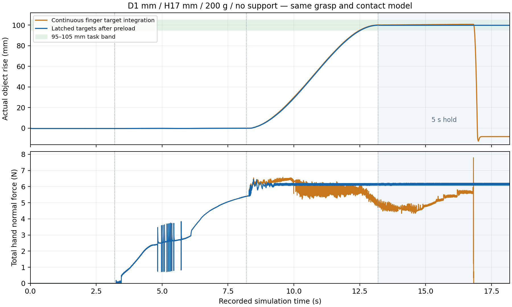

# Φ1 mm、200 g 圆柱：高度探索、严格成功与完整动画

**已在H17 mm、无托工况实现100 mm提升目标、连续5秒稳定持握及真实释放，并通过全部原有严格判据。另做3次全新目录的独立完整重复，全部再次严格通过。** 本轮最小已严格重复验证的高度是17 mm；这不是已证明的硬件最小可抓高度。

- [严格成功单次全流程动画](h017_strict_success_plain.mp4)
- [最终六工况总览](height_boundary_overview.mp4)
- [17 mm无托／浅托](h017_latch_plain_vs_shallow.mp4) · [20 mm对比](h020_latch_plain_vs_shallow.mp4) · [60 mm对比](h060_latch_plain_vs_shallow.mp4)
- [17 mm持续积分与锁存控制的同输入前后对照](h017_axis_vs_latch_plain.mp4)
- [全部动画、文档及源码主包](height_boundary_animations_and_docs.zip)
- [完整结果CSV](search-results.csv) · [结果及源哈希JSON](search-results.json) · [管线MD](PIPELINE.md)

## 严格成功的实测结果

Φ1×17 mm、200 g、初始竖直、无托。真实手物初始间距约97.636 mm，手先远离静置，再接近、闭合夹紧、受力预载、提升、持握、释放。全程重力开启，物体自由，没有焊接、吸附、额外物体力或阶段内位姿重置。

- 5000个连续1 ms持握步，实际升高 **99.716290–99.782066 mm**；末值 **99.737027 mm**。
- 全5秒拇指／食指持续正法向承载、物体无桌面／托座支撑；持握手物最大穿透 **30.136 μm**，低于原50 μm门槛。
- 持握位置最大漂移 **0.066077 mm**，全四元数姿态漂移 **0.111111°**；相对闭合参考旋转 **6.629987°**，均通过原门。
- 最后充分松指并退离，物体真实掉落并接触桌面，零手物接触；无数值警告或意外重置。

成功采用明确的 **5秒预载**，随后5秒提升、5秒到位持握；不能称作原1秒加载方案成功。三次新增重复保持相同输入、场景、模型、控制与判据，使用独立UUID目录，全部轨迹与发现例逐数组一致。这是确定性复现，未进行初姿噪声或现实硬件鲁棒性认证。

## 最终固定控制策略的六工况

六例都完成连续5秒悬空持握与真实释放。下表将原严格判据完整保留；其余五例相对原闭合参考的最大旋转超过15°，不能标成原严格全流程通过，但持握阶段的姿态漂移都小于10°。

| 高度 | 支撑 | 整个5秒实际升高／mm | 持握位置最大漂移／mm | 持握姿态漂移 | 相对闭合最大旋转 | 原严格全流程 |
|---|---|---:|---:|---:|---:|---|
| 17 mm | 无托 | 99.716–99.782 | 0.066 | 0.111° | 6.630° | 通过 |
| 17 mm | 浅托 | 99.663–99.730 | 0.070 | 0.071° | 43.521° | 仅闭合参考旋转未过 |
| 20 mm | 无托 | 99.389–99.444 | 0.253 | 1.644° | 16.260° | 仅闭合参考旋转未过 |
| 20 mm | 浅托 | 99.588–99.656 | 0.071 | 0.125° | 43.168° | 仅闭合参考旋转未过 |
| 60 mm | 无托 | 98.720–98.815 | 0.653 | 9.865° | 161.148° | 仅闭合参考旋转未过 |
| 60 mm | 浅托 | 99.382–99.446 | 0.343 | 6.508° | 50.956° | 仅闭合参考旋转未过 |

六例采用同一字节冻结的latch控制参数。H17/H20把同一手形放在杆顶下2 mm，H60保留原中段抓点；关节、朝向相同，根位置按各输入明确平移。因此这展示同一控制策略下各记录输入的性能，不是只有高度变化的六格因果实验。17 mm浅托没有比无托更好的原姿态结果，不能预设加托必然改善抓取。

## 为什么这次成功

仅把旧H10动作平移到H20/40/80没有完成提升。新的D5承载种子经真实手部运动后拟合，改善了两侧几何接近；法向力积分进一步建立双指夹力。延长预载能建足力，但两指接触点上下错开会产生倾转力矩，单独增大夹力仍掉杆。

沿杆轴调整两指接触高度后，H60已能实际举起并持握；但持续的指目标积分会让接触继续迁移，部分样本持握时旋转或最终掉落。最终策略在预载结束后 **锁存已达到的原位置执行器目标**，提升／持握期间保持原位置伺服工作，停止追加法向／轴向积分；没有把物体固定到手上。

H17无托的持续积分与锁存对照使用完全相同的输入NPY和实际MJB。持续积分样本在5秒持握结束前失抓，锁存样本通过全部原判据；控制目标变化是这组明确模型内对照的差异。

完整曲线提供PNG/SVG及源SHA；曲线读自每1 ms实测诊断，没有重做物理步。

## 探索范围与边界的准确含义

本轮正式保留的高度是17、20、40、60、80 mm，包含原动作粗探索、拟合输入、控制对照、固定策略及独立重复。12–240 mm初始场景种子的零步编译审计、H120辅助拟合、未启动的H30/H80后续探针均不能算完整抓取试验。

更低的H16顶下2 mm输入在隔离手部几何诊断中出现约17 μm桌面侵入，H15/H16未在本轮进行正式提升；也没有用不合格静态候选冒充真实失败。**17 mm是本轮最小已严格重复验证成功高度，不是“16 mm不可抓”的证明。** 不同抓型、抓点及控制下的失败不构成单调高度阈值或硬件极限。

## 判据、补充诊断及透明性

原严格`full_sequence_passed`要求实际95–105 mm连续5秒、每步双指正载荷和无支撑、微尺度穿透门、位置／全四元数旋转／漂移、真实释放、零异常。H17无托发现及3次重复 **直接通过这些原门**，不依赖补充指标。

早期H60样本虽然完成提升、持握、释放，却绕圆柱自身轴旋转；观察该现象后新增的任务与对称性诊断明确标为事后补充，并与原严格标签并列保存，没有覆盖原结果。64边网格只有离散5.625°轴向对称，不能冒称其与原生圆柱的连续SO2对称完全相同。1 ms与5 ms／25 Hz轴诊断的分辨率和可证明范围分别记载。

共保留 **39套**完整正式记录、其中 **4套**原严格通过（同一H17无托工况的发现+3次重复），不是四个不同成功工况。记录中还包含额外控制探索及确定性参考重放，不能把该数量解释为硬件成功概率。发生过一次两个进程共享输出ID的交叉启动事件，只保留一套可审文件，已在execution-ledger单列，未用于重复成功证明。

| 原记录控制profile | 保留记录数 |
|---|---:|
| `normal_integrator_contact_axis_latch_preload5` | 9 |
| `normal_integrator_contact_axis_preload5` | 10 |
| `original` | 11 |
| `normal_integrator_micro_anchor` | 4 |
| `normal_integrator_contact_axis_root_twist_preload5` | 1 |
| `normal_integrator_contact_axis_twist_conditioned_preload5` | 1 |
| `normal_integrator_contact_axis_twist_preload5` | 1 |
| `normal_integrator_micro_anchor_preload5` | 2 |

## 动画、数据与复现

交付 **39段完整正式单片＋6段对比／总览，共45段视频**。每段从远离起点开始，完整保留接近、夹紧、预载、提升、持握和释放；重复试验保留各自独立源身份。原严格失败、补充任务达成与原严格成功分别标明，没有把指令100 mm当成实际物体升高。

动画仅从原25 Hz状态回放、10 fps编码，调用mj_forward而不积分、不插值；近景仅改变相机。完整MJB、参考XML、原输入、轨迹、1 kHz诊断与控制反馈原字节按高度／支撑另行分包；主包包含全部动画、报告、源码、场景、独立QA、公开模型资产和许可证。下载后需安装相同依赖并重定位工作区路径；精确MJB回放使用MuJoCo3.3.3。

质量始终按用户条件固定200 g，因体积变化密度随高度改变；该基准不代表同一种普通材料的实物杆系列。微接触参数属于明确的模型设定，仿真成功不替代实机验证。
